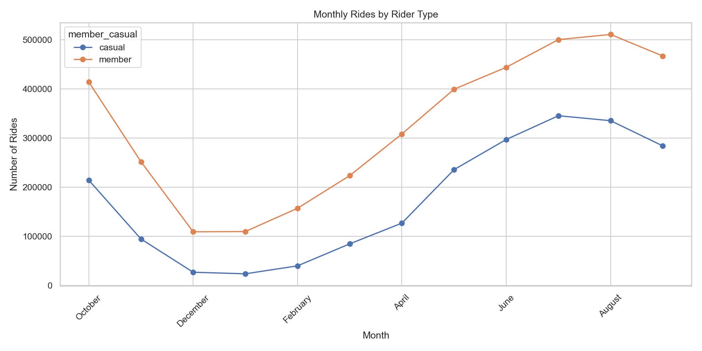
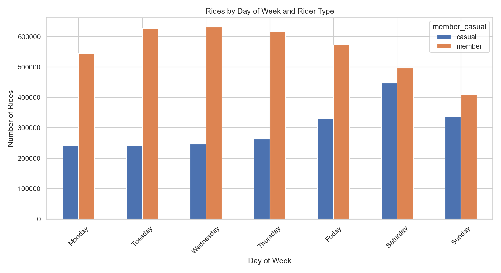
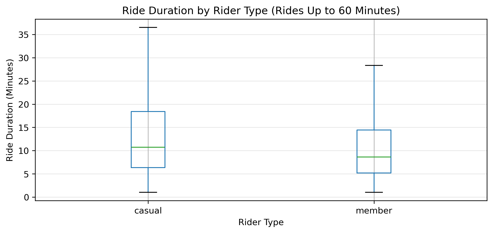
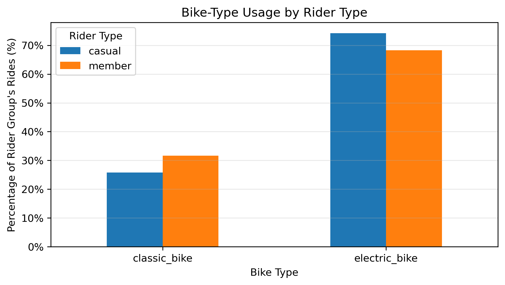

# Cyclistic: Bike-Share User Behaviour Analysis

## Project Overview

This project analyses more than 6 million bike-share rides to understand differences between casual riders and annual members. Using Python, SQL, and Tableau, I investigated riding patterns, compared rider behaviour, and identified potential opportunities for membership marketing.

The project demonstrates a complete data analysis workflow, including data collection, cleaning, exploratory data analysis, SQL-based business analysis, dashboard development, and evidence-based recommendations.

## Business Objective

The objective is to understand how casual riders differ from annual members and use those findings to develop data-driven hypotheses for marketing campaigns that could encourage casual riders to become members.

**Target audience:** Cyclistic marketing team and business decision-makers.

**Desired business outcome:** Identify promising campaign opportunities that can be tested and evaluated using membership conversion, acquisition cost, and retention metrics.

## Research Questions

1. How do casual riders and annual members differ in overall riding activity?
2. How does usage vary by month and season?
3. How do riding patterns differ between weekdays and weekends?
4. At what times of day are the two rider groups most active?
5. Do the groups differ in ride duration?
6. Do casual riders and members prefer different bike types?
7. Which starting and ending stations are used most frequently by each group?
8. What testable marketing opportunities can be derived from these patterns?

## Data Source and Scope

The data comes from the official Divvy trip-data archive:

[Divvy Trip Data — Official Data Archive](https://divvy-tripdata.s3.amazonaws.com/index.html)

The analysis covers rides starting between **October 1, 2025, and September 30, 2026**.

The unit of analysis is an individual ride. The rider classification is stored in `member_casual`, with the values `member` and `casual`.

The dataset contains trip-level information such as ride start and end timestamps, bike type, station information, coordinates, and rider classification.

## Project Workflow

The project follows a structured data analysis process:

1. Define the business problem, audience, and research questions.
2. Acquire the monthly source files and inspect their structure.
3. Combine, clean, and prepare the data in Python.
4. Perform exploratory data analysis and create derived features.
5. Use SQL to investigate business questions.
6. Build an interactive Tableau dashboard.
7. Interpret the findings and develop business recommendations.
8. Validate outputs and document reproducibility considerations.
9. Prepare the final portfolio presentation.

## Data Cleaning and Preparation

The monthly source files were combined and processed in Python using Pandas and NumPy.

Key preparation steps included:

- Combining the monthly files for the selected analysis period.
- Inspecting column names, data types, missing values, and duplicate records.
- Removing 35 duplicate rows.
- Converting timestamps and calculating ride duration.
- Removing negative-duration rides, rides shorter than one minute, and rides longer than 24 hours.
- Retaining rides with a duration of exactly 24 hours.
- Creating derived time features for monthly, seasonal, weekday, and hourly analysis.
- Checking missing station information and its implications for station-level analysis.
- Validating the cleaned dataset and exporting it for further analysis.

Duration thresholds are analytical filtering decisions. They help focus the analysis on plausible trip durations but do not establish that every excluded record was erroneous.

### Final Dataset and Quality Checks

| Metric | Result |
|---|---:|
| Final rows | 6,007,154 |
| Final columns | 22 |
| Duplicate ride IDs | 0 |
| Missing start timestamps | 0 |
| Missing end timestamps | 0 |
| Negative-duration rides | 0 |
| Rides shorter than one minute | 0 |
| Rides longer than 24 hours | 0 |
| Rides outside the target period | 0 |

The cleaned dataset contains **6,007,154 rides and 22 columns**.

Missing station information remains a limitation. Station-level analyses exclude records without the station identifiers or names required for the specific analysis.

## Key Findings

### 1. Overall Rider Distribution

The cleaned dataset contains the following distribution:

| Rider group | Number of rides | Share of rides |
|---|---:|---:|
| Members | 3,896,850 | 64.87% |
| Casual riders | 2,110,304 | 35.13% |
| **Total** | **6,007,154** | **100.00%** |

Members account for approximately two-thirds of recorded rides. These figures describe trips, not the number of unique people.

### 2. Monthly Riding Patterns

Monthly activity varies across the year.

- Casual rides peak in **July**, with 345,551 rides.
- Member rides peak in **August**, with 511,009 rides.
- Both groups have lower activity during winter months.
- Casual riding activity shows a stronger concentration in summer than member activity.

### Seasonal Distribution

| Season | Casual riders | Members |
|---|---:|---:|
| Winter | 4.31% | 9.66% |
| Spring | 21.22% | 23.91% |
| Summer | 46.36% | 37.35% |
| Autumn | 28.11% | 29.08% |

The share of casual rides occurring in summer is **9.01 percentage points higher** than the corresponding share for members.

**Business implication:** Summer may be a promising period to test membership campaigns. However, seasonality alone does not demonstrate that a campaign will increase conversion.

### 3. Weekday and Weekend Riding Patterns

The distribution of rides across the week differs between casual riders and members.

| Day | Casual riders | Members |
|---|---:|---:|
| Monday | 11.51% | 13.96% |
| Tuesday | 11.45% | 16.11% |
| Wednesday | 11.69% | 16.20% |
| Thursday | 12.47% | 15.78% |
| Friday | 15.69% | 14.69% |
| Saturday | 21.19% | 12.76% |
| Sunday | 16.00% | 10.50% |

These percentages represent each rider group's distribution of rides across the days of the week.

| Metric | Casual riders | Members |
|---|---:|---:|
| Weekend share of rides | 37.19% | 23.26% |

The weekend share is **13.93 percentage points higher for casual riders** than for members.

**Business implication:** Weekend-focused messaging is a reasonable hypothesis to test with casual riders. A controlled campaign would be needed to determine whether it increases membership conversion.

### 4. Hourly Riding Patterns

Hourly activity provides additional context for when the two groups use the service.

- Members show stronger morning peaks during commuting hours.
- Both groups reach their highest hourly share at approximately 5 p.m.
- Casual riders have a relatively larger share of rides during parts of the middle of the day and late evening.

These patterns may be consistent with different use cases, but trip data alone cannot establish whether a ride was for commuting, recreation, tourism, or another purpose.

### 5. Ride Duration

Ride duration differs between the two rider groups.

| Metric | Casual riders | Members |
|---|---:|---:|
| Mean ride duration | 18.17 minutes | 12.17 minutes |
| Median ride duration | 11.14 minutes | 8.69 minutes |

The median ride duration for casual riders is approximately **28.2% longer** than the median for members.

The mean is higher than the median for both groups, indicating right-skewed duration distributions. A small number of longer rides can therefore influence the mean.

If the accompanying histogram is limited to rides of 60 minutes or less, that range should be stated in the chart title or caption. The median figures above refer to the cleaned dataset rather than only the plotted subset.

**Business implication:** Differences in ride duration may help inform messaging, but duration alone does not explain membership choice or prove that longer rides lead to conversion.

### 6. Bike-Type Preferences

The share of rides by bike type differs between casual riders and members.

| Bike type | Casual riders | Members |
|---|---:|---:|
| Electric bike | 74.20% | 68.32% |
| Classic bike | 25.80% | 31.68% |

Casual riders have a higher electric-bike ride share, by **5.88 percentage points**.

**Business implication:** Electric-bike access or value could be explored as a potential membership message, provided that the relevant benefits and pricing are confirmed against the actual membership terms.

### 7. Station Usage

Station-level analysis identifies frequently used starting and ending stations for each rider group.

The analysis groups records by station identifier and name and excludes missing or blank station information where necessary.

The results suggest differences in the stations frequently used by casual riders and members. These differences should be interpreted cautiously because a substantial proportion of rides lack station information.

Station usage alone cannot establish a rider's purpose, demographic profile, or likelihood of becoming a member.

Further station-specific findings can be explored in the interactive Tableau dashboard.

## Business Recommendations

The findings suggest several hypotheses that could be tested by the marketing team.

### 1. Test Weekend-Focused Membership Campaigns

Casual riders have a higher share of weekend rides than members.

A campaign could test membership messaging tailored to weekend usage patterns. The campaign should be evaluated against a suitable control group to determine whether it produces additional conversions.

### 2. Test Seasonal Campaigns

Casual riding activity is concentrated more strongly in summer.

A campaign could be tested during periods of higher casual-rider activity. Its timing and effectiveness should be evaluated using campaign and conversion data rather than assumed from ride volume alone.

### 3. Evaluate Bike-Type Messaging

Casual riders have a higher electric-bike ride share.

Marketing could test whether communicating relevant electric-bike benefits affects membership interest, provided the messaging accurately reflects the available membership terms.

### 4. Measure Outcomes Rather Than Engagement Alone

Campaign evaluation should focus on business outcomes such as:

- Incremental membership conversion rate.
- Cost per incremental conversion.
- Membership retention after conversion.
- Differences between campaign and control groups.

These recommendations are hypotheses derived from descriptive analysis. The current dataset does not contain campaign exposure or conversion outcomes, so it cannot establish whether the proposed campaigns will cause an increase in membership.

## Tableau Dashboard

Explore the interactive Tableau dashboard:

[**View the Cyclistic Tableau Dashboard**](https://public.tableau.com/app/profile/marcin.szczepa.ski1297/viz/Cyclistic_Ride_Behaviour_2026/Cyclistic)

The dashboard provides interactive views of rider behaviour across time, weekday, season, bike type, and station usage.

It complements the Python and SQL analysis by allowing users to explore the patterns using filters.

## Tools and Technologies

| Tool | Purpose |
|---|---|
| Python | Data cleaning, preparation, and exploratory analysis |
| Pandas and NumPy | Data manipulation and calculations |
| Matplotlib and Seaborn | Statistical and exploratory visualizations |
| SQL / MySQL | Business-focused aggregation and analysis |
| Tableau | Interactive dashboard and data storytelling |
| Jupyter Notebook | Documented analytical workflow |

## Project Files

The repository separates code, documentation, and visual outputs.

- `notebooks/` — Python notebook for data preparation and analysis.
- `sql/` — SQL scripts for database setup and business analysis.
- `figures/` — Selected visualizations used in this README.

## Reproducibility and Quality Assurance

The project includes documented data-cleaning steps, quality checks, and an exported cleaned dataset used for subsequent analysis.

Validation performed in Python confirmed that the in-memory cleaned dataset and exported CSV had matching dimensions and column names. The final dataset contains 6,007,154 rows and 22 columns.

The workflow also includes checks for duplicate ride IDs, missing timestamps, invalid durations, and records outside the target period.

To reproduce the analysis on another computer, users may need to:

1. Download the required monthly source files from the official data archive.
2. Install the necessary Python libraries.
3. Adjust local file paths where necessary.
4. Configure MySQL and import the cleaned dataset.
5. Open the Tableau dashboard or configure the relevant project files.

The initial SQL import script uses a local file path and may need to be updated on another computer. Full cell-by-cell equality between the in-memory dataset and exported CSV was not established by the shape and column-name checks alone.

## Limitations

Several limitations should be considered when interpreting the findings:

- **Trip counts are not unique customers.** A person may generate multiple rides.
- **No demographic information.** The dataset does not identify rider age, income, or other personal characteristics.
- **No campaign or conversion data.** The analysis cannot determine which rides resulted in membership purchases or whether marketing caused conversion.
- **Missing station information.** Station-level findings are based on a subset of rides with the required station data.
- **Potential external influences.** Weather, tourism, holidays, daylight, pricing, and bike availability were not tested.
- **Descriptive analysis.** Observed differences identify patterns and hypotheses, not causal relationships.
- **One-year scope.** The results describe the selected 12-month period and may not generalize to other years or locations.

## Conclusion

This analysis identifies meaningful differences between casual riders and members in seasonal activity, weekend riding, ride duration, hourly patterns, and bike-type preferences.

The strongest marketing hypotheses are to test weekend-focused and seasonal campaigns, while evaluating whether bike-type messaging has an effect. These opportunities should be validated through controlled campaigns and measured using incremental conversion, acquisition cost, and retention.

The project demonstrates an end-to-end data analysis workflow using Python, SQL, and Tableau, translating trip-level data into business-focused findings and testable recommendations.
